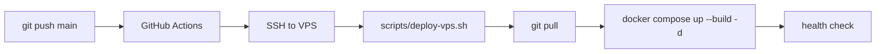

# Auto-deploy: GitHub main → Hostinger VPS

When you push to **`main`**, GitHub Actions SSHs into your VPS, pulls the latest code, rebuilds Docker, and runs health checks.

Manual deploy from your laptop is still available via **`scripts/deploy-push.sh`**.

---

## Production checklist (Hostinger)

| Item | On VPS |
|------|--------|
| Repo | `/var/www/Zaroor-shop` cloned from GitHub |
| Secrets | `server/.env` (from `server/.env.example`, **never in git**) |
| Docker | `docker compose up --build -d` |
| Nginx | `deploy/nginx/zaroor.shop.conf.example` enabled |
| SSL | Certbot for `zaroor.shop` + `www` |
| DNS | A `@` and CNAME `www` → VPS IP `187.127.119.183` |
| `NODE_ENV` | `production` in `server/.env` |
| Swagger | Disabled in production (`/api-docs` only in dev) |

---

## One-time: GitHub Actions secrets

In GitHub: **zaroorshop/Zaroor-shop** → **Settings** → **Secrets and variables** → **Actions** → **New repository secret**

| Secret name | Value |
|-------------|--------|
| `DEPLOY_HOST` | `187.127.119.183` |
| `DEPLOY_USER` | `root` |
| `DEPLOY_REMOTE_DIR` | `/var/www/Zaroor-shop` |
| `DEPLOY_SSH_PRIVATE_KEY` | Full private key file contents (same key you use for `ssh -i ~/.ssh/hostinger_vps`) |

**Private key:** paste the entire file including `-----BEGIN ... KEY-----` lines. Do not commit this key to the repo.

**VPS:** ensure the matching **public** key is in `/root/.ssh/authorized_keys` (or use the key Hostinger gave you).

---

## One-time: VPS can pull from GitHub

On the VPS:

```bash
cd /var/www/Zaroor-shop
git remote -v
git pull origin main
```

Use SSH remote (`git@github.com:zaroorshop/Zaroor-shop.git`) with a deploy key, or HTTPS with a token.

---

## How auto-deploy works



Workflow file: `.github/workflows/deploy-hostinger.yml`  
VPS script: `scripts/deploy-vps.sh`

---

## Manual deploy from laptop (recommended script)

One command from your project folder:

```bash
cp .env.deploy.example .env.deploy
nano .env.deploy
./scripts/deploy.sh "describe your change"
```

What it does:

1. `git commit` + `git push origin main` (GitHub over SSH)
2. SSH to VPS → `git pull` → `docker compose up --build -d` → health check

Other modes:

```bash
./scripts/deploy.sh --push-deploy    # already committed; only push + deploy
./scripts/deploy.sh --deploy-only    # already on GitHub; only update VPS
```

---

## Manual deploy on VPS only

```bash
cd /var/www/Zaroor-shop
./scripts/deploy-vps.sh
```

---

## Troubleshooting CI deploy

| Problem | Fix |
|---------|-----|
| SSH permission denied | Check `DEPLOY_SSH_PRIVATE_KEY` secret and `authorized_keys` on VPS |
| `git pull` failed | Fix GitHub deploy key / credentials on VPS |
| Health check failed | `docker compose logs server` on VPS |
| Workflow not running | Push must be to **`main`** branch |

View runs: GitHub → **Actions** tab.
